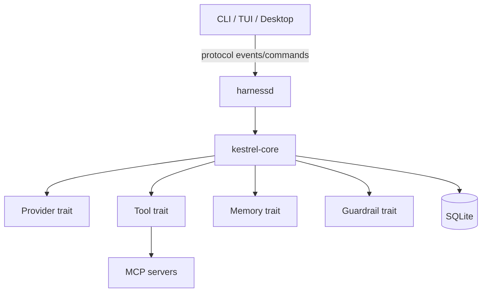

# Ushabti

Modular, recipe-driven AI agent harness in Rust with a terminal UI and a desktop app. Users compose a harness by selecting modules (model provider, tools, memory, guardrails, channels, system prompt) in a `recipe.yaml`.

## Why Rust

Memory safety, single static binary, low idle memory, strong typing for the protocol shared across CLI, TUI, desktop and daemon.

## Features

- Recipe-driven composition (provider, tools, memory, guardrails, channels, prompt)
- Agent loop with streaming, parallel tool calls, retries, cancellation
- Built-in tools: read_file, edit_file, bash, glob, grep, patch, web_fetch
- MCP client (stdio + streamable HTTP) with namespaced tools
- Approvals in core with timeout and deny-by-default
- Sessions persisted in SQLite; resume
- Guardrails: spend cap, PII redaction
- Terminal UI (ratatui) and desktop app
- Daemon (harnessd) with WebSocket + REST
- Eval replay and regression reports

## Architecture



## Install

- Prebuilt binary: download from GitHub releases, verify checksum.
- cargo install: `cargo install --path crates/cli` (builds `harness`).
- From source: clone, `cargo build --release`.

## Quick start (terminal)

```
export HARNESS_API_KEY=...
harness -p "list files in src"
```

## Quick start (desktop)

Launch the desktop app and point it at a recipe.

## Recipe walkthrough

See docs/book for the full reference. Minimal example:

```yaml
name: minimal
model: { provider: openai, model: gpt-4o-mini }
tools: [read_file]
```

## Comparison

Based on docs/REFERENCE-NOTES.md (references were unavailable at review time; comparison pending real study).
EOF